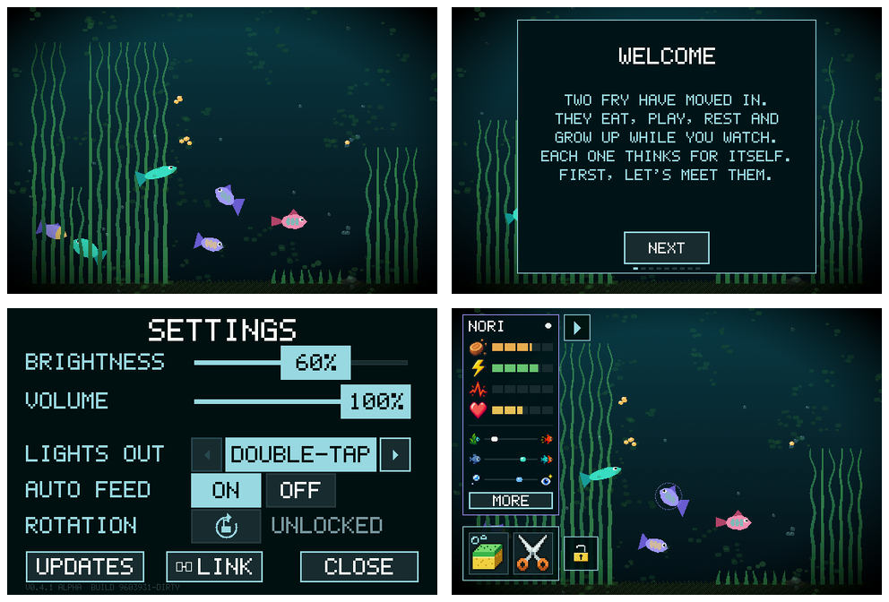

# Waveshare ESP32-S3-Touch-LCD-3.5B-C

Board source: [Waveshare's official repository](https://github.com/waveshareteam/ESP32-S3-Touch-LCD-3.5B),
revision `c7dd63c70258da7e3b6dae0c621f30ca62b1e1c9`, factory BSP and V1/V2 schematics.
The vendor panel register sequence is retained in `firmware/main/lcd35b_init.inc`;
its Apache-2.0 license is in `docs/vendor/waveshare-LICENSE`.

USB ROM query confirmed ESP32-S3 revision v0.2, 240 MHz, 8 MB embedded
PSRAM and 16 MB quad flash. It has the same
processor and memory capacity as the original supported boards. The larger
physical LCD has 320 x 480 pixels, fewer pixels than the original AMOLED.

## Hardware map

| Peripheral | Wiring / capabilities |
| --- | --- |
| Shared I2C | SDA 8, SCL 7, 400 kHz |
| AXS15231B LCD | QSPI CS 12, clock 5, data 1/2/3/4; native 320 x 480 |
| LCD backlight | GPIO 6, 5 kHz PWM, LEDC timer/channel 0 |
| AXS15231B capacitive touch | I2C 0x3b, two-point controller, first point used |
| TCA9554 | I2C 0x20; EXIO1 shared LCD/touch reset, EXIO6 PWR sense |
| AXP2101 | I2C 0x34; power, battery gauge, charging and PWR interrupts |
| QMI8658 | Accelerometer/gyroscope; upstream uses acceleration for handling/orientation |
| PCF85063 | I2C 0x51; real-time clock |
| ES8311 | I2C 0x18/0x19; MCLK 44, BCLK 13, LRCLK 15, MCU audio out 16, microphone in 14 |
| OV5640 camera | XCLK 38, PCLK 41, VSYNC 17, HREF 18, data 45/47/48/46/42/40/39/21; shared SCCB/I2C |
| MicroSD | 1-bit SDMMC, clock 11, command 10, data 9 |
| Radios | Wi-Fi and Bluetooth LE; Pocket Tank leaves Bluetooth disabled |

Camera capture, microphone recording and SDMMC are board capabilities, not
new tank features. They are not initialized by this port. In particular,
the original audio amplifier GPIO 46 is a camera data pin here: never use
the AMOLED audio pin map on this board.

## Display and touch

The world is 552 x 368 (3:2), uniformly scaled and rotated to fill the
480 x 320 landscape glass, with no side margins, stretching or cropping.
The original 448 x 368 pages remain centered inside that wider world, so
all controls retain their proportions and remain visible.
`lcd35b_geometry.h` supplies both display and touch maps; all screen pixels
are active. The original narrow-world save is migrated by upstream
progression relayout; the saved record layout does not change. The algae
grid uses 532 cells, within the existing 644-cell save allocation.
Grass cache headers use ten coordinate bits for worlds wider than 512
pixels; the other boards retain their original nine-bit representation. Existing gestures use the shared upstream touch
code, without the AMOLED's device-specific calibration offsets. AXS input
bridges failed/invalid reads and confirms finger-up across multiple reports,
so a single held finger is not split into repeated taps. For quick bare-water HAND gestures, two consecutive complete idle-fill
replies confirm release without an extra delay, keeping double taps
separate when reads cluster around a frame transfer. Menus, cards,
buttons, tools and longer holds retain 60 ms idle confirmation so contact
gaps do not repeatedly activate a held control.
Double-tap empty water with the Hand tool, then pause briefly, to toggle
manual lighting. The state diagnostics report the lighting mode and tool.
Physical bring-up established +Y as the IMU's upright direction for this
landscape mapping (the original board uses -Y). Display and touch consume
the same orientation result, including a 180-degree turn.

Every frame starts at native row zero, then sends consecutive 16-row internal
DMA strips. AXS15231B QSPI does not support an independent row address.
Buffers are reused only after DMA completion. The backlight comes on after
the first full frame. Driver 1.0.0 interprets `disp_on_off` as an
`off` flag: `false` enables the picture and `true` blanks it. This differs
from the ESP-IDF API name and is also documented in the vendor BSP. The port uses synchronous flushing; frame rate
must be measured on hardware rather than assumed from upstream's AMOLED.



The preview is generated by the simulator, not a photograph of the board.
Settings use a full-width canvas, larger touch targets and scale-3 body
text (50% larger than the initial port), with matching hit tests.

## Power and updates

Do not apply the AMOLED's rail-trimming list. Preserve the factory rails,
enable the audio analog rail and retain the vendor's DCDC1 forced-PWM fix
for low-brightness flicker. Disable the factory application's PMIC watchdog;
the firmware keeps upstream's ESP task watchdog. Audio idling powers down
the codec without cutting the shared analog supply.

The firmware identifies itself as `lcd35b`, including its OTA image marker.
Upstream has no release manifest for this custom board. Upstream AMOLED
updates must not be installed; use local cable builds until a dedicated
signed update feed exists. The local RSA signing key is ignored by Git.

## Build and install

Install and export ESP-IDF v5.4.3 with its ESP32-S3 toolchain. From the
repository root, generate a local signing key once, then build:

```sh
mkdir -p firmware/keys
python -m espsecure generate_signing_key --version 2 --scheme rsa3072 firmware/keys/ota_signing_key.pem
chmod 600 firmware/keys/ota_signing_key.pem
bash tools/flash.sh --lcd35b --build-only
```

Build output is `firmware/build-lcd35b/`. The sdkconfig combines upstream
defaults with `sdkconfig.lcd35b`; the trained model ships in `model/out/`.
Keep the signing key local and retain it for your future updates.

Set `TANK_PORT` explicitly to your board's USB serial path. On Linux,
prefer `/dev/serial/by-id/...` so a reset changing ttyACM numbers does not
change the target; on macOS use the board's `/dev/cu.usbmodem...` path.

Before replacing factory firmware, put the board into download mode and
create a full recovery image outside the checkout:

```sh
export TANK_PORT=/path/to/your/board-serial-port
python tools/backup_lcd35b.py --port "$TANK_PORT" --output ../pocket-tank-backups/factory.bin
bash tools/flash.sh --lcd35b --first-install ../pocket-tank-backups/factory.bin
```

The backup command creates both `factory.bin` and `factory.bin.json`. It
refuses to overwrite an existing recovery image. The first-install command
checks the backup's 16 MB size, SHA256 and USB serial metadata against the
connected device before changing flash. It records recovery metadata
locally, clears factory NVS, writes the model/trailer and installs the
signed application, bootloader, partition table and OTA selection.
Factory firmware and backup metadata are device-specific; keep them local.

For later updates, omit `--first-install`:

```sh
bash tools/flash.sh --lcd35b
```

Updates require the existing director/battery-log preflight, preserve NVS
and skip rewriting the model. The native USB connection exits manually
entered download mode using a watchdog reset. This script is for this
LCD board; check the product model before installing it.

## Validation

`make -C sim LCD35B=1` builds the wider-world simulator as `fishsim-lcd35b`.
Ten focused checks passed in this world: board/save migration, actual AXS
touch-port routing, cards, floor, depth, grass loop and patching, render
stack, sleep and LLM. The four original worlds also pass their grass loop,
grass patch and touch-port regressions (12 checks). The full upstream suite
stops at `--selftest-plant-under` on the reference world. This failure
(12 layer/persistence assertions) was independently reproduced on pristine
upstream `952ef4d`; the full upstream suite has not passed.

The board-specific firmware compiles under ESP-IDF v5.4.3. The host geometry
test checks all accepted and rejected native pixels, boundaries and corners:

```sh
cc -std=c11 -Wall -Wextra -Werror firmware/host_test/lcd35b_geometry_test.c -o /tmp/lcd35b-geometry
/tmp/lcd35b-geometry
```

Hardware bring-up confirmed display, audio output, IMU/RTC/codec detection,
on-device AI decisions, saves across updates and automatic orientation.
The owner confirmed the final Rotation-button hold and water double-tap
light gesture both work correctly. The full-screen tank picture was also
confirmed on hardware; the preview above is from the simulator.

The final touch regression covers a single tap and hold leaving the light
alone, fast double taps switching it off/on, clustered polls around a frame
transfer, and held controls across transient idle/corrupt/timeout reports.
Initial measured rendering was approximately 12–15 fps, below upstream's
AMOLED numbers. An overnight soak and USB-only battery-state reporting
remain work to do; no long-term stability claim is made.

## Desk operation

Manual lighting and automatic feeding are already the upstream defaults.
Keep USB connected for continuous operation. Automatic idle lighting is an
optional setting, distinct from explicit PWR sleep and PMIC power-off.
First establish display/touch/audio/save behavior, then validate unattended
USB operation, orientation lock, brightness, thermal behavior, resets and
power-loss recovery over a sustained run. A day/night schedule would be a subsequent feature with its own behavior checks.
